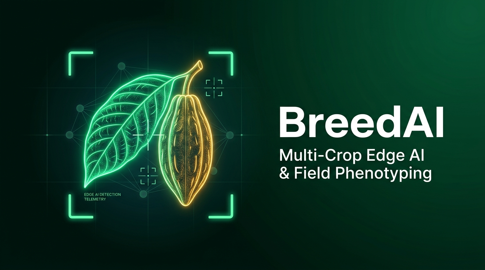
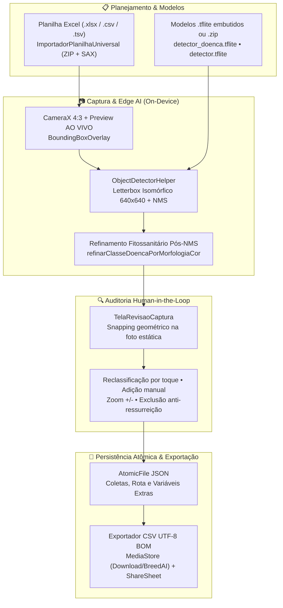

<div align="center">
  
</div>

# 🧬 BreedAI — Fenotipagem Agronômica Multi-Culturas Offline-First & Edge AI

<p align="center">
  <a href="https://github.com/Igor8818/BreedAI/actions/workflows/android-ci.yml">
    
  </a>
  
  
  
  
  
  <a href="LICENSE">
    
  </a>
</p>

Aplicativo Android nativo **100% offline e independente de servidor** para fenotipagem digital em campo com Visão Computacional embarcada (**TensorFlow Lite / YOLOv8**), projetado com foco em usabilidade rápida para melhoramento genético e experimentação agrícola multi-culturas.

> 🌱 **Origem e Evolução Arquitetural:** O **BreedAI** nasceu como a evolução generalista do motor de Visão Computacional *on-device* originalmente validado no ecossistema institucional CEPEC/CEPLAC ([**CacauApp**](https://github.com/Igor8818/CacauApp) + [**CacauSync**](https://github.com/Igor8818/CacauSync)). Enquanto o `CacauApp` é acoplado às regras e API do ensaio de cacau, o **BreedAI** desacopla completamente o back-end e generaliza identificadores, variáveis fenotípicas, planilhas Excel/CSV e modelos `.tflite`/`.zip` para **qualquer cultura ou experimento agronômico**.

---

## 🧭 CacauApp Ecosystem vs. BreedAI

| Característica | **BreedAI** (Este Repositório) | **CacauApp + CacauSync** (Ecossistema CEPEC) |
| :--- | :--- | :--- |
| **Escopo** | Generalista Multi-Culturas (*Open-Source*) | Vertical Institucional CEPEC / CEPLAC (`TC-1801`) |
| **Infraestrutura** | **100% Standalone no Aparelho** (sem servidor) | Mobile + Back-end Spring Boot 3 + PostgreSQL + Web React |
| **Modelos de IA** | Embutidos + Importação & Exportação **`.zip`** (`model.tflite` + manifesto JSON) | Foco em detecção e doenças do cacaueiro |
| **Planilhas de Rota** | Leitura nativa offline de **`.xlsx` (Excel)**, `.csv` e `.tsv` | Rotas `.csv` e envio via ponte USB ADB |
| **Variáveis de Campo** | **Dinâmicas e configuráveis** (`Numérico`, `Texto`, `Lista de Opções`) | Colunas fitossanitárias fixas do ensaio clonal |

---

## 🏛️ Pipeline & Arquitetura Offline-First



---

## ✨ Funcionalidades Principais

### 1. Navegação Direta & UX Enxuta (`NavigationBar`)
Sem menus hambúrguer ocultos: a barra inferior dá acesso direto em 1 toque aos 5 fluxos principais:
* **Coleta Livre *(tela inicial)*:** Foco máximo no campo com seleção rápida de **Tratamento** (autocompletar do histórico), contadores ergonômicos (`−` / `+`) para **Parcela** e **Planta** (com aviso quando já coletada), botão rápido **`+ Variáveis`**, registro imediato de **Sem Frutos (0)** ou **Não Coletável** (`Pequena`, `Morta`, `Errada`, `Cavalo`), **Galeria** e **Abrir Câmera**.
* **Modo Rota:** Navegação sequencial planta a planta (`#1 → #N`) a partir da planilha carregada, destacando tratamento, parcela, planta e progresso da quadra.
* **Dados (`N`):** Consulta das plantas coletadas com filtros por `SituacaoPlanta`, edição de variáveis extras, reabertura da revisão visual de caixas na foto, exclusão e exportação/compartilhamento de CSV.
* **Modelo IA:** Gerenciador completo de modelos embarcado no celular.
* **Ensaio:** Diálogo rápido para renomear a coleta ativa, configurar variáveis extras ou iniciar nova coleta zerada.

### 2. Multi-Modelos Embutidos & Portabilidade Total (`.tflite` / `.zip`)
* **Dois modelos YOLOv8 Float32 pré-carregados e prontos para uso offline:**
  1. `detector_doenca.tflite` — Modelo multi-classe para diagnóstico fitossanitário (`PodridaoParda`, `Moniliase`, `Sadio`, `VassouraBruxa`) com refinamento morfológico/cromático pós-NMS (`refinarClasseDoencaPorMorfologiaCor`) para distinção precisa de frutos vassourados necrosados vs. podridão parda.
  2. `detector.tflite` — Modelo clássico de contagem geral de frutos.
* **Importação & Exportação em `.zip`:** Importe qualquer modelo `.tflite` (YOLOv8, YOLOv11 ou SSD) de forma permanente para o armazenamento interno do aparelho, ajuste rótulos (`labelsFiltro`), limiar de confiança e limite de detecções, e **exporte pacotes `.zip`** (`model.tflite` + `model_config.json`) para compartilhar modelos calibrados com toda a equipe.

### 3. Importação Nativa de Planilhas Excel (`.xlsx`) & CSV/TSV
* **`ImportadorPlanilhaUniversal.kt`:** Lê planilhas **`.xlsx` nativamente offline** via `ZipInputStream` + `SAXParserFactory` (compatível com Android `minSdk 24+` sem dependências pesadas como Apache POI no mobile), além de arquivos `.csv` e `.tsv` com detecção automática de codificação (**UTF-8 BOM** / **Windows-1252**) e delimitadores (`;`, `,`, `\t`, `|`), com mapeamento automático ou assistido das colunas de Tratamento, Parcela e Planta.

### 4. Pipeline Geométrico Edge AI & Revisão Pós-Foto (`TelaRevisaoCaptura`)
* **Letterbox Isomórfico + Snap Geométrico:** Mantém a proporção original do fruto na entrada `640x640` do tensor e re-executa inferência estática pós-captura com fusão inteligente (`fundirDeteccoesComSnapping`), eliminando desalinhamentos causados por movimento entre o preview e o obturador.
* **Auditoria por Toque (*Human-in-the-Loop*):** Em cachos densos, o toque seleciona a caixa cujo centro está mais próximo; permite reclassificar classes com 1 toque, adicionar objetos não detectados, ajustar dimensões (`−` / `+`) e excluir caixas sem que a re-detecção as recrie (*anti-ressurreição*).

### 5. Variáveis Fenotípicas Configuráveis & Exportação Offline Segura
* **Variáveis Extras (`VariavelExtra`):** Pré-carregadas (`Cor do Fruto`, `Nota de Vírus`, `Diâmetro do Tronco (cm)`) e expansíveis livremente com tipos **Numérico**, **Texto** ou **Lista de Opções** — todas adicionadas automaticamente como colunas extras na exportação.
* **Persistência Atômica & CSV Padronizado:** Escrita local protegida contra corrupção via `AtomicFile` (`registros_breedai_local.json`, `formulario_breedai.json`, `variaveis_extras_breedai.json`) e exportação CSV RFC 4180 com **UTF-8 BOM** diretamente para `Download/BreedAI` via `MediaStore` + compartilhamento rápido via `FileProvider`.

---

## 📁 Estrutura do Projeto

```text
app/src/main/java/com/example/myapplication/
├── MainActivity.kt                              # Shell principal (BreedAIApp), NavigationBar, Modo Rota e Coleta Livre
├── data/
│   ├── ModelConfig.kt                           # Catálogo de modelos embutidos, manifesto .zip e labels
│   ├── PontoFormulario.kt                       # Entidade de linha da planilha de campo
│   └── RegistroColeta.kt                        # Entidades RegistroColeta, SituacaoPlanta e VariavelExtra
└── userinterface/
    ├── ComponentesFieldBook.kt                  # Câmera fullscreen, seletor de situação e variáveis extras
    ├── TelaConfiguracaoModelo.kt                # Seleção de modelos, importação permanente e exportação .zip
    ├── TelaEdicaoDados.kt                       # Filtros por situação, revisão, edição e exportação CSV
    ├── TelaRevisaoCaptura.kt                    # Auditoria geométrica pós-foto (snap, toque, resize e reclassificação)
    └── util/
        ├── ObjectDetectorHelper.kt              # Engine TFLite (Letterbox, YOLO decoding, NMS e refinamento fitossanitário)
        ├── ImportadorPlanilhaUniversal.kt       # Parser offline nativo para .xlsx (ZIP+SAX) e .csv/.tsv
        ├── PersistenciaLocalRegistros.kt        # Armazenamento atômico JSON e SharedPreferences
        ├── FileUtils.kt                         # Exportação CSV dinâmica UTF-8 BOM + FileProvider
        └── CameraUtils.kt                       # Pipeline CameraX 4:3, EXIF e BoundingBoxOverlay
```

---

## 🛠️ Stack Tecnológica

| Camada | Tecnologias |
| :--- | :--- |
| **Linguagem & SDK** | Kotlin `2.0.21`, Android SDK (`minSdk 24`, `targetSdk 36`, AGP `9.0.0`, Gradle `9.1.0`) |
| **UI & Navegação** | Jetpack Compose, Material Design 3, NavigationBar, Material Icons Extended, Coil `2.6.0` |
| **Câmera & Visão Computacional** | CameraX `1.5.3`, TensorFlow Lite `2.16.1` (+ GPU Delegate), YOLOv8 Float32 (`640x640`) |
| **Planilhas & Persistência** | `SAXParserFactory` + `ZipInputStream` (`.xlsx`), `AtomicFile`, JSON nativo Android |
| **Hardware & Localização** | Google Play Services Location `21.2.0` (`FusedLocationProviderClient`), EXIF orientation |
| **Qualidade & CI** | JUnit 4, Mockito `5.11.0`, `org.json`, GitHub Actions CI |

---

## 🏗️ Como Compilar, Testar e Instalar

### Pré-requisitos
* Android Studio (JDK 17+ / JDK 21) e Android SDK (`compileSdk 36`).
* Aparelho Android físico ou emulador com depuração USB ativada.

### Clonar e Rodar Testes + Build Debug

```bash
git clone https://github.com/Igor8818/BreedAI.git
cd BreedAI
./gradlew testDebugUnitTest assembleDebug --no-daemon
```

No Windows PowerShell (com JDK do Android Studio):

```powershell
$env:JAVA_HOME = "C:\Program Files\Android\Android Studio\jbr"
.\gradlew.bat testDebugUnitTest assembleDebug --no-daemon
adb install -r app\build\outputs\apk\debug\app-debug.apk
```

---

## 🧪 Suíte de Testes Automatizados (**27 Testes Unitários**)

Todos os testes executam na JVM via `./gradlew testDebugUnitTest` sem necessidade de emulador:

| Suíte de Teste | Quantidade | Cobertura |
| :--- | :---: | :--- |
| `CsvParsingUnitTest` | 4 | Parser nativo `.xlsx` (ZIP+SAX), CSV UTF-8 BOM / Windows-1252 e auto-detecção de delimitadores |
| `LetterboxAndGeometryUnitTest` | 9 | Letterbox isomórfico, projeção inversa, IoU, snapping geométrico e redimensionamento de caixas |
| `ModelAndStateUnitTest` | 7 | Manifesto `.zip`, `SituacaoPlanta`, `VariavelExtra`, integridade e `refinarClasseDoencaPorMorfologiaCor` |
| `YoloDetectionAndScaleUnitTest` | 6 | Decodificação de tensores YOLO, mapeamento de classes e assinatura dos modelos embutidos `.tflite` |
| `DomainConcordanceIntegrationTest` | 1 | Fluxo completo offline: coleta + variáveis extras + revisão -> JSON -> CSV dinâmico |

---

## 📄 Licença & Autor

Distribuído sob a licença **MIT**. Consulte o arquivo [`LICENSE`](LICENSE) para mais detalhes.

**Igor Sena Hagge**  
Engenheiro de Software — Mobile (Kotlin / Jetpack Compose & React Native), Back-end (Java / Spring Boot) & Edge AI  
* **GitHub:** [@Igor8818](https://github.com/Igor8818)
* **LinkedIn:** [linkedin.com/in/igorhagge](https://www.linkedin.com/in/igorhagge/)
* **E-mail:** [igor.senna2@hotmail.com](mailto:igor.senna2@hotmail.com)
