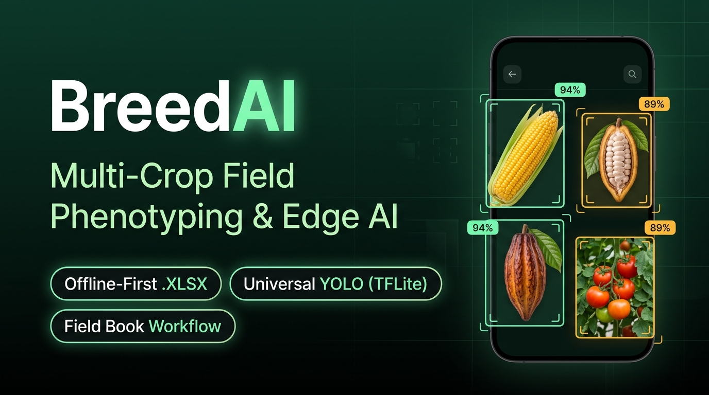
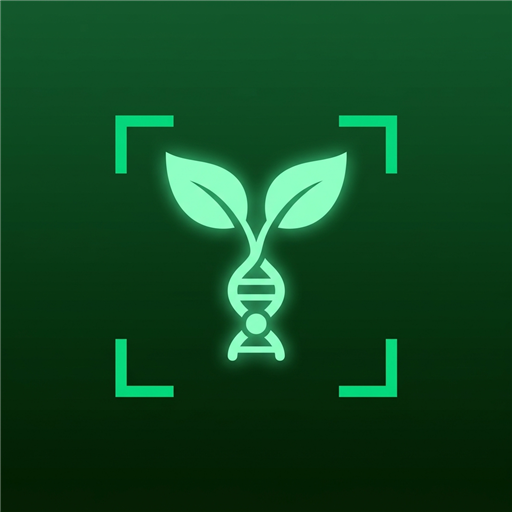
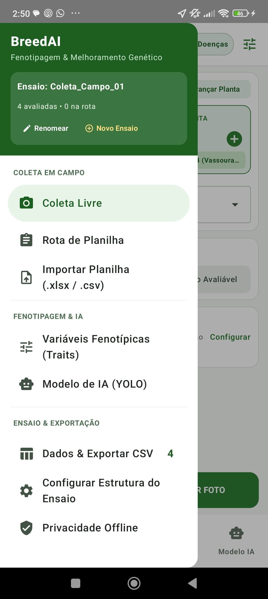
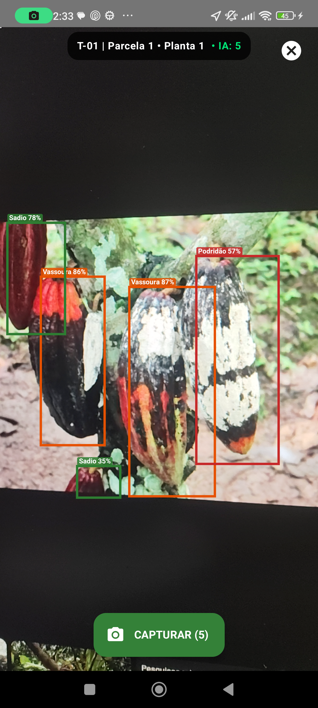
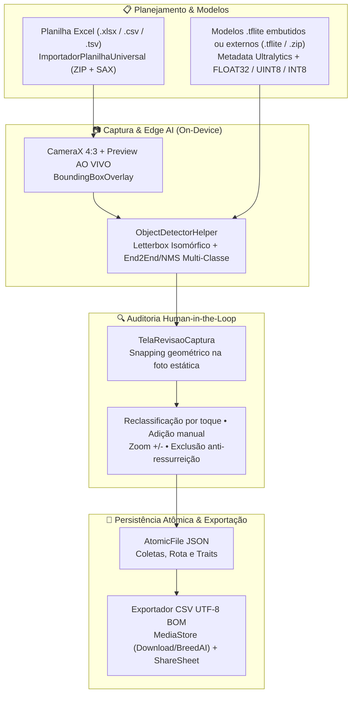

<div align="center">
  
</div>

<br/>

<div align="center">
  
  <h1>BreedAI — Plataforma Android Open-Source Offline-First &amp; Motor Universal Edge AI</h1>
</div>

<p align="center">
  <a href="https://github.com/Igor8818/BreedAI/actions/workflows/android-ci.yml">
    
  </a>
  
  
  
  
  
  <a href="LICENSE">
    
  </a>
</p>

Plataforma Android nativa **100% standalone, offline-first e independente de servidor** para coleta estruturada de dados e inferência de Visão Computacional *on-device* (**TensorFlow Lite / Runtime Universal YOLO & SSD**), com **parser streaming próprio de planilhas Excel (`.xlsx` via ZIP + SAX XML)**, campos customizáveis em tempo de execução e importação dinâmica de pacotes de modelos `.zip`.

> 🧩 **Arquitetura Desacoplada & Extensível:** O **BreedAI** generaliza em um produto *open-source* (pronto para Google Play com R8/ProGuard) o motor de Visão Computacional validado originalmente em sistemas corporativos ([**CacauApp**](https://github.com/Igor8818/CacauApp) + [**CacauSync**](https://github.com/Igor8818/CacauSync)), removendo acoplamento com servidor e suportando **qualquer modelo `.tflite` de detecção de objetos (`FLOAT32`, `UINT8`, `INT8` e `End2End NMS`)** em qualquer domínio de inspeção visual.

---

## 📸 Experiência Visual (Estilo Field Book + Edge AI)

<div align="center">
  <table>
    <tr>
      <td align="center" width="33%">
        <b>Coleta Livre (Field Book UX)</b><br/><br/>
        
        <br/><sub>Tema verde agronômico, contadores simétricos Parcela/Planta e Traits</sub>
      </td>
      <td align="center" width="33%">
        <b>Gestão do Ensaio e Coletas</b><br/><br/>
        
        <br/><sub>Acesso rápido ao ensaio ativo, rotas .xlsx/.csv, Traits e modelo IA</sub>
      </td>
      <td align="center" width="33%">
        <b>Detecção YOLO On-Device</b><br/><br/>
        
        <br/><sub>Inferência em tempo real + snap geométrico e auditoria pós-foto</sub>
      </td>
    </tr>
  </table>
</div>

---

## 🧭 CacauApp Ecosystem vs. BreedAI

| Característica | **BreedAI** (Este Repositório) | **CacauApp + CacauSync** (Ecossistema CEPEC) |
| :--- | :--- | :--- |
| **Escopo** | Generalista Multi-Culturas (*Open-Source*, Google Play Ready) | Vertical Institucional CEPEC / CEPLAC (`TC-1801`) |
| **Infraestrutura** | **100% Standalone no Aparelho** (sem servidor) | Mobile + Back-end Spring Boot 3 + PostgreSQL + Web React |
| **Motor de IA** | **Universal YOLO/SSD**: `[1,C,N]`, `[1,N,C]`, **`End2End NMS [1,N,6]`**, **`INT8`/`UINT8`/`FLOAT32`**, leitura de metadados Ultralytics | Foco em detecção e doenças do cacaueiro |
| **Planilhas de Rota** | Leitura nativa offline de **`.xlsx` (Excel)**, `.csv` e `.tsv` | Rotas `.csv` e envio via ponte USB ADB |
| **Variáveis de Campo** | **Traits dinâmicos e configuráveis** (`Numérico`, `Texto`, `Lista de Opções`) | Colunas fitossanitárias fixas do ensaio clonal |

---

## 🏛️ Pipeline & Arquitetura Offline-First



---

## ✨ Funcionalidades Principais

### 1. UX Agronômica Inspirada no Field Book (`BreedAITheme`)
* **TopAppBar Limpa + `NavigationBar` Inferior (4 Abas):**
  * **Início:** Painel da coleta ativa, gestão de múltiplas coletas isoladas, escolha do perfil de cultura, atalhos para rendimento e anotações extras.
  * **Coletar (Modo Rota / Modo Livre):** Alterna entre navegação sequencial planta a planta a partir de planilhas `.xlsx`/`.csv` e coleta livre rápida com contadores simétricos de **Parcela**/**Planta**, autocompletar de **Tratamento**, estado fenotípico (`Normal`, `Sem Frutos`, `Não Avaliável`) e câmera IA / galeria.
  * **Dados:** Painel de resumo (**Plantas**, **Total**, **Média vivas**, **Estande**), ranking por tratamento, filtros por situação, revisão visual de caixas e exportação de CSV, resumo em texto e pacote ZIP.
  * **Modelo IA:** Seleção de modelos pré-carregados, **Modo Combinado (2 IAs)**, importação permanente de `.tflite` ou pacotes `.zip`, teste ao vivo na câmera e ajuste fino de confiança mínima e classes.

### 2. Motor Universal YOLO / TFLite (`ObjectDetectorHelper.kt`)
* **Multi-Arquitetura Automática:** Decodifica tensores padrão **YOLOv5 / YOLOv8 / YOLOv11** (`[1, C, N]` e `[1, N, C]`), **YOLO End-to-End NMS (`[1, N, 6]`: YOLOv10 / YOLO26)** e modelos **SSD MobileNet**.
* **Quantização Completa (`FLOAT32`, `UINT8`, `INT8`):** Pré-processamento com tabela de conversão (*LUT*) pré-calculada em byte e dequantização automática dos tensores de saída.
* **Desacoplamento Multi-Cultura & Metadados Ultralytics:** Extração automática do dicionário `names` embutido em FlatBuffers Ultralytics (`extrairLabelsMetadadosUltralytics`). Regras fitossanitárias específicas do cacau (`isModeloDoencaCacau`) são isoladas e jamais aplicadas a modelos genéricos de outras culturas.
* **NMS Multi-Classe:** Supressão consciente de classe (`nmsMultiClasse`), preservando objetos de classes diferentes com sobreposição parcial e evitando duplicações na mesma classe.

### 3. Multi-Modelos Embutidos & Portabilidade Total (`.tflite` / `.zip`)
* **Padrão multi-cultura de contagem:** Inicia pronto com `detector.tflite` para contagem geral sem acoplamento fitossanitário, mantendo `detector_doenca.tflite` disponível para diagnóstico multi-classe ou **Modo Combinado (2 IAs)**.
* **Pacotes `.zip` compartilháveis:** Exporte e importe pacotes contendo `model.tflite` + `model_config.json` para padronizar configurações e rótulos em toda a equipe.

### 4. Importação Nativa de Planilhas Excel (`.xlsx`) & CSV/TSV
* **`ImportadorPlanilhaUniversal.kt`:** Lê planilhas **`.xlsx` nativamente offline** via `ZipInputStream` + `SAXParserFactory` (compatível com Android `minSdk 24+` sem dependências pesadas), além de `.csv` e `.tsv` (**UTF-8 BOM** / **Windows-1252** e delimitadores `;`, `,`, `\t`, `|`).

### 5. Pipeline Geométrico & Auditoria Pós-Foto (`TelaRevisaoCaptura`)
* **Letterbox Isomórfico + Snap Geométrico:** Mantém a proporção original do objeto na entrada do modelo e re-executa inferência estática pós-captura com fusão inteligente (`fundirDeteccoesComSnapping`), eliminando desalinhamentos entre o preview e o disparo.
* **Auditoria por Toque (*Human-in-the-Loop*):** Permite reclassificar objetos por toque, adicionar manualmente, ajustar dimensões (`−` / `+`) e excluir caixas sem que a re-detecção as recrie (*anti-ressurreição*).

### 6. Prontidão Google Play & Privacidade Offline
* Regras ProGuard/R8 configuradas em [`app/proguard-rules.pro`](app/proguard-rules.pro) para builds release com TensorFlow Lite, CameraX e classes de domínio.
* Diálogo informativo transparente confirmando **processamento 100% local no aparelho**, sem envio de fotos para servidores externos.

### 7. Conversão de Rendimento & Ranking
* **Presets Comerciais Multi-Cultura:** Converte automaticamente contagens de campo para arrobas (`@` de 15 kg), sacas (`sc` de 60 kg), caixas (`cx` de 20 kg), peso puro (`kg`) ou parâmetros personalizados, com desconto opcional de frutos doentes e projeção por hectare ponderada pelo estande.
* **Ranking & Pacote Completo ZIP:** Classifica tratamentos por média aproveitável, gera resumo compartilhável em texto e empacota em `.zip` a planilha principal, `resumo_tratamentos.csv`, `classes.txt`, fotos originais e rótulos no formato YOLO.

---

## 📁 Estrutura do Projeto

```text
app/src/main/java/com/example/myapplication/
├── MainActivity.kt                              # BreedAITheme, Drawer, TopAppBar, NavigationBar, Rota e Coleta Livre
├── data/
│   ├── ModelConfig.kt                           # Catálogo de modelos embutidos, manifesto .zip e labels
│   ├── PontoFormulario.kt                       # Entidade de linha da planilha de campo
│   └── RegistroColeta.kt                        # Entidades RegistroColeta, SituacaoPlanta e VariavelExtra
└── userinterface/
    ├── ComponentesFieldBook.kt                  # Câmera fullscreen, Estado Fenotípico e Variáveis (Traits)
    ├── TelaConfiguracaoModelo.kt                # Seleção de modelos, modo combinado, importação e exportação .zip
    ├── TelaEdicaoDados.kt                       # Resumo do ensaio, filtros, revisão e exportação CSV
    ├── TelaRevisaoCaptura.kt                    # Auditoria geométrica pós-foto (snap, toque, resize e reclassificação)
    └── util/
        ├── ObjectDetectorHelper.kt              # Engine universal TFLite (Letterbox, YOLO/End2End/INT8, NMS multi-classe)
        ├── ImportadorPlanilhaUniversal.kt       # Parser offline nativo para .xlsx (ZIP+SAX) e .csv/.tsv
        ├── PersistenciaLocalRegistros.kt        # Armazenamento atômico JSON e SharedPreferences
        ├── FileUtils.kt                         # Exportação CSV dinâmica UTF-8 BOM + FileProvider
        └── CameraUtils.kt                       # Pipeline CameraX 4:3, EXIF e BoundingBoxOverlay
```

---

## 🛠️ Stack Tecnológica

| Camada | Tecnologias |
| :--- | :--- |
| **Linguagem & SDK** | Kotlin `2.0.21`, Android SDK (`minSdk 24`, `targetSdk 36`, AGP `9.0.0`, Gradle `9.1.0`) |
| **UI & Navegação** | Jetpack Compose, Material Design 3 (`BreedAITheme`), `TopAppBar`, `NavigationBar` (4 abas), Coil `2.6.0` |
| **Câmera & Visão Computacional** | CameraX `1.5.3`, TensorFlow Lite `2.16.1` (CPU + XNNPACK), YOLO Universal (`FLOAT32` / `UINT8` / `INT8`) |
| **Planilhas & Persistência** | `SAXParserFactory` + `ZipInputStream` (`.xlsx`), `AtomicFile`, JSON nativo Android |
| **Hardware & Localização** | Google Play Services Location `21.2.0` (`FusedLocationProviderClient`), EXIF orientation |
| **Qualidade & Release** | JUnit 4 (**82 testes unitários**), Mockito `5.11.0`, ProGuard/R8 rules, GitHub Actions CI |

---

## 🏗️ Como Compilar, Testar e Instalar

```bash
git clone https://github.com/Igor8818/BreedAI.git
cd BreedAI
./gradlew testDebugUnitTest assembleDebug --no-daemon
```

No Windows PowerShell (com JDK do Android Studio):

```powershell
$env:JAVA_HOME = "C:\Program Files\Android\Android Studio\jbr"
.\gradlew.bat testDebugUnitTest assembleDebug --no-daemon
adb install -r app\build\outputs\apk\debug\app-debug.apk
```

---

## 🧪 Suíte de Testes Automatizados (**82 Testes Unitários**)

Todos os testes executam na JVM via `./gradlew testDebugUnitTest` sem necessidade de emulador:

| Suíte de Teste | Quantidade | Cobertura |
| :--- | :---: | :--- |
| `ComprehensivePersistenceImportAndAITest` | 11 | Multi-coletas isoladas, parser `.xlsx` completo, integridade `TFL3`, YAML/TXT, revisão geométrica e `VolumeShutterBridge` |
| `ComprehensiveYieldAndExportTest` | 16 | Templates e presets de rendimento, estande, ranking por tratamento, resumo de texto, CSV e pacote ZIP em background |
| `CsvParsingUnitTest` | 4 | Parser nativo `.xlsx` (ZIP+SAX), CSV UTF-8 BOM / Windows-1252 e auto-detecção de delimitadores |
| `DomainConcordanceIntegrationTest` | 4 | Fluxo completo offline -> JSON -> CSV dinâmico com colunas da planilha, rendimento (`@`/kg) e percentuais opcionais |
| `LetterboxAndGeometryUnitTest` | 12 | Letterbox isomórfico, projeção inversa, IoU, snapping geométrico, alças de canto e redimensionamento de caixas |
| `ModelAndStateUnitTest` | 19 | Modelos embutidos, isolamento da heurística de cacau (`isModeloDoencaCacau`), manifesto `.zip`, rendimento e ranking |
| `YoloDetectionAndScaleUnitTest` | 16 | Decodificação YOLO / `End2End NMS [1,N,6]` / EfficientDet 2-out, `nmsMultiClasse`, metadados Ultralytics e fusão de modelos |

---

## 📄 Licença & Autor

Distribuído sob a licença **MIT**. Consulte o arquivo [`LICENSE`](LICENSE) para mais detalhes.

**Igor Sena Hagge**  
Engenheiro de Software — Mobile (Kotlin / Jetpack Compose & React Native), Back-end (Java / Spring Boot) & Edge AI  
* **GitHub:** [@Igor8818](https://github.com/Igor8818)
* **LinkedIn:** [linkedin.com/in/igorhagge](https://www.linkedin.com/in/igorhagge/)
* **E-mail:** [igor.senna2@hotmail.com](mailto:igor.senna2@hotmail.com)
